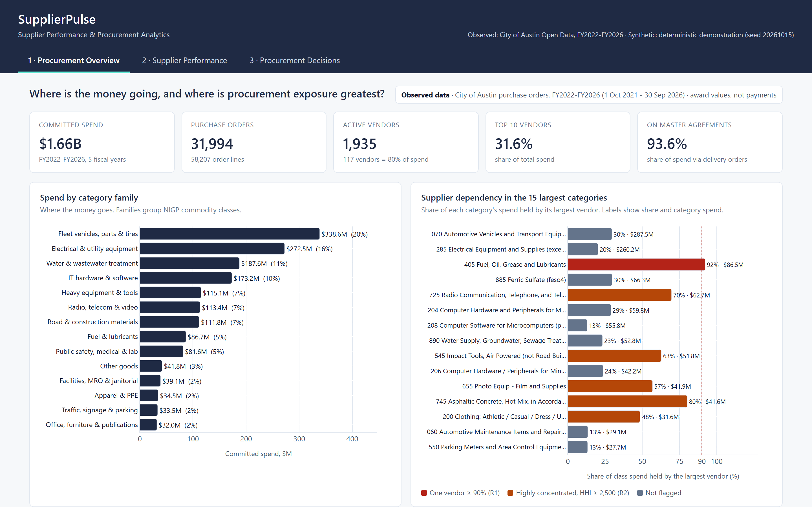

# SupplierPulse

### Supplier Performance & Procurement Analytics

An analytical procurement system that evaluates supplier performance, purchasing spend, and operational risk to identify opportunities for better purchasing decisions.



<sub>Genuine dashboard screenshot. Spend and concentration use **observed** City of Austin purchase orders (FY2022–FY2026). Supplier delivery views use a clearly labelled **synthetic** dataset, because the public data has no delivery dates.</sub>

**[Dashboard](deliverables/SupplierPulse_Dashboard.html)** · **[Excel workbook](deliverables/SupplierPulse_Procurement_Analysis.xlsx)** · **[Decision brief (PDF)](deliverables/SupplierPulse_Decision_Brief.pdf)** · **[SQL](sql/README.md)** · **[Methodology](docs/methodology.md)**

## Business question

**Which suppliers are performing reliably, where is purchasing risk concentrated, and what procurement actions should a business prioritise?**

## Three verified findings (observed City of Austin data, FY2022–FY2026, $1.66B awarded)

1. **Risk sits inside categories, not in total spend.** The largest vendor holds only 5.1% of awarded value, and 117 vendors account for 80%. But 52 of the 79 categories with more than $1M of spend are highly concentrated (HHI ≥ 2,500). In 6 of them, one vendor holds at least 90% ($126.2M).
2. **Fuel is the largest single-vendor exposure.** One vendor supplied 92% of $86.5M in fuel and lubricants, across 261 purchase orders over five years. This is an exposure to review, not evidence of a poor supplier.
3. **Identical items repriced sharply.** For 20 distribution-transformer items, prices rose a median 34% (up to 119%) from FY2022 to FY2023. The rise holds at 34% when order sizes are held comparable.

All three were recomputed independently from the source and match ([analytical audit](docs/analytical_audit.md)).

## Three recommendations

1. **Fuel:** review the award history and confirm a tested contingency source, such as a secondary award or backup agreement, before the next renewal.
2. **Electrical equipment:** benchmark prices against market indices, use capped index-linked price clauses, and plan long-lead transformer purchases earlier.
3. **Supplier performance:** record promised and receipt dates on every PO line, so delivery can be scored. SupplierPulse's [synthetic demonstration](docs/synthetic_data.md) shows the scorecard, exception rules and a *modelled* volume-reallocation scenario that this would enable.

## Tools used

**Python** (pandas) for validation, metrics, scoring and scenarios · **SQL** (DuckDB) for 12 business queries checked against Python · **Excel** for a 17-sheet workbook of live formulas · **Plotly/HTML** for an offline three-view dashboard · **pytest** for 74 tests. Power BI was not used.

## Methodology and data disclosures

- **Source:** City of Austin, [*Purchase Order Quantity Price detail for Commodity/Goods procurements*](https://data.austintexas.gov/d/3ebq-e9iz), built 5 Oct 2026. It's offered "free and without restriction" under the City's [Open Data Terms of Use](https://data.austintexas.gov/d/2z87-8uh7). Spend means **awarded PO value**, not payments.
- **Privacy:** the repository holds a **minimal-column snapshot**, not the original file. It has no names, addresses, contract text or free-text descriptions, and vendor IDs are pseudonymous. Business names (170) and product descriptions (153) appear only from human-reviewed lists. See [data sources](docs/data_sources.md) and the [privacy review](docs/privacy_review.md).
- **Synthetic data:** delivery, OTIF, quality and scorecard results use 14 fictional suppliers (`SUP-01` … `SUP-14`). No real company is rated on delivery.
- **Modelled figures**, such as price harmonisation and scenarios, are opportunities to investigate, not savings.
- Further reading: [methodology](docs/methodology.md) · [data-quality audit](docs/data_quality_audit.md) · [data dictionary](docs/data_dictionary.md).

## Run it locally (Windows PowerShell)

```powershell
git clone https://github.com/harjotsandhu24/supplierpulse-procurement-analytics.git
cd supplierpulse-procurement-analytics
python -m venv .venv; .\.venv\Scripts\Activate.ps1
pip install -r requirements-dev.txt; pip install -e .
python -m supplierpulse.pipeline            # ~30 s: tables, DuckDB + SQL, workbook, dashboard, brief, audit
pytest -m "not slow"                        # ~4 min; plain `pytest` adds the Excel recalculation (~8 min total)
start deliverables\SupplierPulse_Dashboard.html
```

## Reproducibility

- **From a clean clone:** the committed snapshot (`data/public/`) reproduces every published number; no private files are needed. Add `--render` to regenerate the screenshots and PDF with Microsoft Edge.
- **From the live source:** `python -m supplierpulse.ingest --download --snapshot` downloads the current CSV to a git-ignored folder and rebuilds the snapshot using the reviewed lists. The City rebuilds the data weekly, so the numbers will drift.
- **Review queue:** `python -m supplierpulse.ingest --review` lists new descriptions or vendor names that need review. They stay excluded until a person approves them.

Step-by-step guide: [docs/windows_setup.md](docs/windows_setup.md).

---

Code and documentation © 2026 Harjot Sandhu, [MIT License](LICENSE). The City of Austin data is **not** covered by that licence; see [THIRD_PARTY_DATA.md](THIRD_PARTY_DATA.md).
