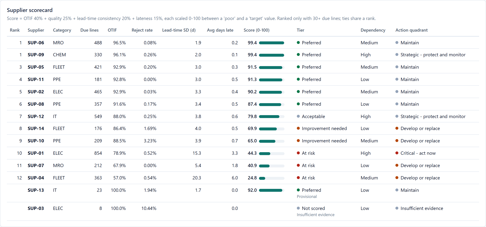
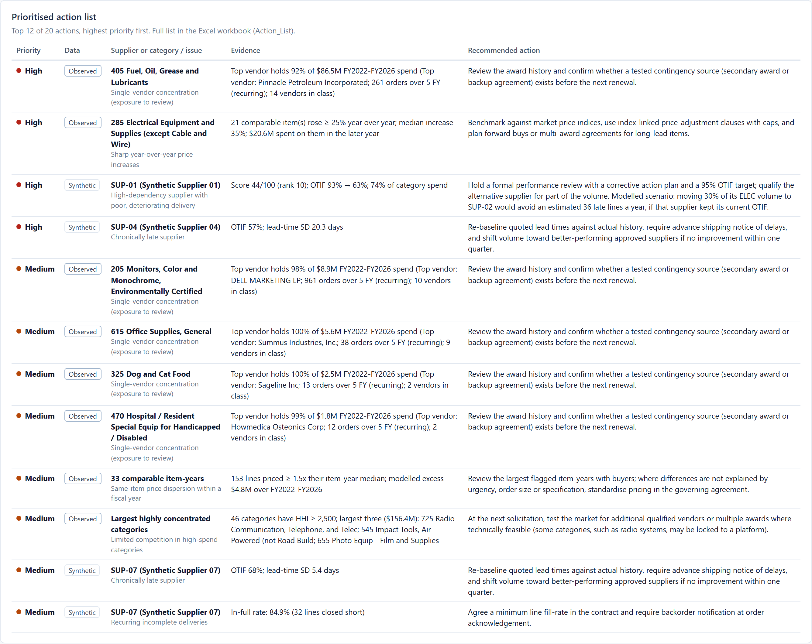
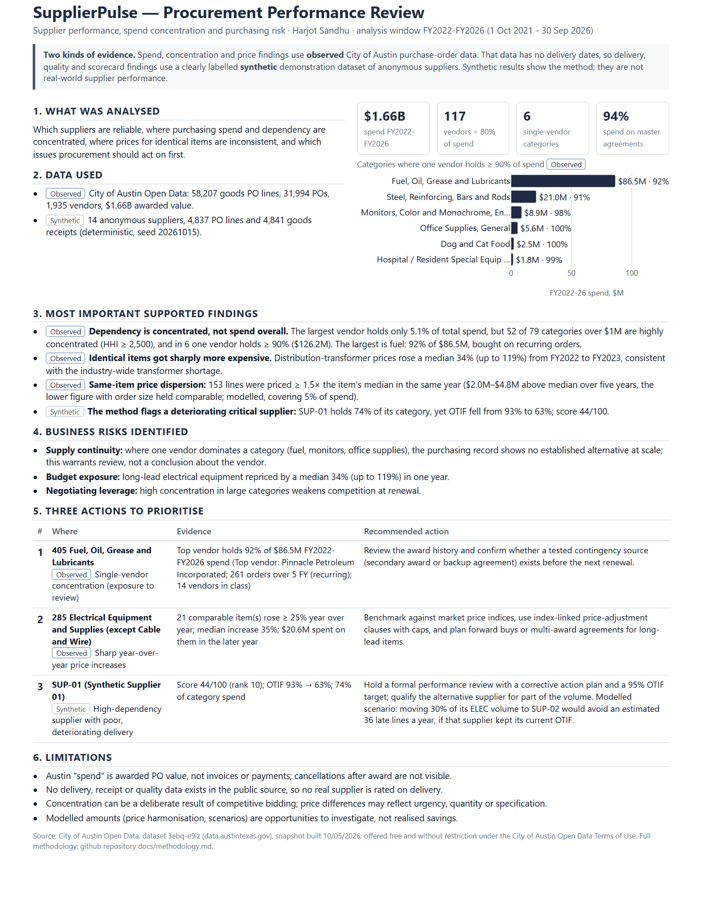

# SupplierPulse — Supplier Performance & Procurement Analytics

An analytical project evaluating supplier reliability, procurement spend, and purchasing risk to support better sourcing decisions.

## Why I built this

Buying well means more than finding the lowest price. A purchasing team needs to know which suppliers deliver reliably, where spending depends on too few vendors, and where it pays different prices for the same item. I built SupplierPulse to practise turning purchasing records into a short list of actions a procurement manager could act on.

## Tools I used

- **Python** to validate and model 321,000 City of Austin purchase-order lines and to score supplier performance
- **SQL** (DuckDB) for 12 procurement queries, cross-checked against the Python results
- **Excel** for a workbook whose scorecard, exception flags and scenario model are live formulas
- **An HTML dashboard** (Plotly) with three views: overview, supplier performance and decisions

## What I did

- Analysed five years of City of Austin purchase orders ($1.66B) for spend, vendor concentration and like-for-like prices.
- Built a supplier scorecard (on-time-in-full, quality, lead-time consistency) with minimum-evidence rules.
- Wrote 14 auditable exception rules and turned them into a prioritised action list.
- Modelled what-if scenarios, such as moving volume away from an unreliable synthetic supplier.

## Visual proof

*Screens from the working dashboard. The City of Austin data has no delivery dates, so supplier delivery views use clearly labelled synthetic data.*

*Overview: spend by category and supplier concentration (observed data).*

*Scorecard: transparent weights; small samples not ranked (synthetic data).*

*Action list: evidence, action and data source for each issue.*

*One-page decision brief for management.*

## What I learned

Total spend looked diversified: the largest vendor held only 5.1% of City of Austin purchasing. The risk sat inside categories. 52 of 79 large categories were highly concentrated, and in six of them one vendor held over 90% of spend. Category-level checks also had to test whether the dependency recurs. The fuel exposure spanned 261 orders over five years, while the second-largest "single-vendor" category came from one contract order.

## What I'd do next

Validate the delivery scorecard on real purchase-order and goods-receipt records with promised and received dates, instead of synthetic ones.

## Links

- **[View GitHub](ADD-AFTER-PUBLISHING)**
- **[Download Excel Analysis](ADD-AFTER-PUBLISHING)** (`deliverables/SupplierPulse_Procurement_Analysis.xlsx`)
- **[Read the One-Page Decision Brief](ADD-AFTER-PUBLISHING)** (`deliverables/SupplierPulse_Decision_Brief.pdf`)

Spend, concentration and price findings use City of Austin Open Data (FY2022–FY2026 purchase orders, offered free and without restriction). Supplier delivery, quality and scorecard results use synthetic demonstration data and are not real-world supplier performance. Modelled amounts are not realised savings.
